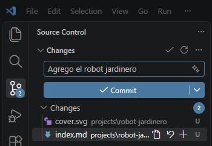
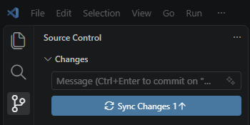

# Guía para agregar y editar proyectos

Cómo cambiar el contenido del sitio desde tu computadora, con VS Code.

**Cómo funciona.** Todos los archivos del sitio están guardados en GitHub, en un *repositorio* (la carpeta
del sitio, con el historial de cada cambio). Vos trabajás sobre una copia de esa carpeta en tu computadora.
Cuando subís tus cambios, GitHub arma el sitio y lo publica solo.

Los textos se escriben en *Markdown*: texto común, donde `# Título` es un título, `**palabra**` va en
negrita y una línea en blanco separa párrafos.

## Antes de empezar (una sola vez)

1. Instalá **Git** (https://git-scm.com/download/win) y **VS Code** (https://code.visualstudio.com).
   *Git* es el programa que guarda y sube los cambios; VS Code lo usa por dentro.
2. Abrí VS Code. En la pantalla de bienvenida elegí **Clone Git Repository...** (Clonar el repositorio
   Git...), pegá `https://github.com/Karevelli/karevelli.github.io` y apretá Enter. Elegí en qué carpeta de
   tu computadora guardarlo y hacé clic en **Select as Repository Destination** (Seleccionar como destino
   del repositorio). Cuando pregunte si querés abrirlo, **Open** (Abrir).
3. VS Code pregunta **Do you trust the authors of the files in this folder?** (¿Confía en los autores de
   los archivos de esta carpeta?). Elegí **Yes, I trust the authors** (Sí, confío en los autores). Si
   contestaste que no, el panel para publicar no funciona: arriba aparece un aviso de **Restricted Mode**;
   hacé clic en **Manage** y después en **Trust** (Confiar).
4. Git anota en cada cambio quién lo hizo. Para decírselo, en VS Code abrí el menú **Terminal** → **New
   Terminal** (Nuevo terminal). Si no ves el menú **Terminal**, está dentro de los tres puntos `...` de la
   barra de menús. Abajo se abre una ventana donde se escriben órdenes; escribí estas dos líneas, cada
   una seguida de Enter, con tu nombre y el correo de tu cuenta de GitHub:

   ```
   git config --global user.name "Karina Belén Revelli"
   git config --global user.email "tu@correo.com"
   ```

5. La primera vez que subas algo, VS Code te pide entrar a tu cuenta de GitHub en el navegador. Aceptá.

Si VS Code está en español, los botones cambian de nombre: al lado de cada uno va el que vas a ver.

## Agregar un proyecto

Cada proyecto es una carpeta dentro de `projects/`.

1. En el panel de la izquierda de VS Code, abrí `projects/`. Hacé clic derecho sobre `_template`,
   **Copy** (Copiar), y después clic derecho sobre `projects`, **Paste** (Pegar).
2. Clic derecho sobre la copia, **Rename...** (Cambiar nombre...), y ponele el nombre del proyecto: en minúsculas,
   sin espacios ni acentos, con guiones (`robot-jardinero`). Ese nombre va a ser la dirección de la
   página: `karevelli.github.io/projects/robot-jardinero/`. No tiene que empezar con `_`: las carpetas que
   empiezan con `_` no se publican.
3. Abrí `index.md` de la carpeta nueva. Arriba hay un *encabezado*: las líneas entre los dos `---`. Las
   líneas que empiezan con `#` son explicaciones; podés borrarlas. Completá:
   - `title:` el nombre del proyecto.
   - `year:` el año.
   - `summary:` una oración que se ve en la tarjeta del proyecto.
   - `cover:` la imagen de la tarjeta, por ejemplo `cover: portada.png`. Si borrás la línea, se usa la
     primera imagen de la carpeta por orden alfabético. La tarjeta muestra la imagen en proporción 4:3
     (como 1600 × 1200) y recorta lo que sobra a los costados o arriba y abajo.
   - `featured:` `true` para mostrarlo en Home, `false` para no.
   - `listed:` `false` lo oculta de las listas (ver [Ocultar](#editar-ocultar-y-destacar)).
4. Debajo del segundo `---`, borrá el texto de ejemplo y escribí el tuyo.
5. Borrá `cover.svg`, que es la imagen de ejemplo, si no la usás.

## Imágenes

Guardá la imagen en la carpeta del proyecto y escribila en el texto, en una línea sola:

```markdown

```

Entre corchetes va una descripción corta: la leen quienes no pueden ver la imagen. Entre paréntesis, el
nombre del archivo, igual que como está escrito en la carpeta (mayúsculas incluidas).

- Nombrá los archivos como las carpetas: sin espacios ni acentos, con guiones (`vista-frente.png`).
- Sirven `.png`, `.jpg`, `.jpeg`, `.webp` y `.gif`.
- Subí la imagen en el tamaño más grande que quieras mostrar. Al publicar, el sitio arma solo versiones más
  chicas, y cada visitante descarga la que le alcanza para su pantalla. Los `.gif` quedan como están.
- Si son muchas, podés ponerlas en una subcarpeta y escribir el nombre con ella adelante:
  ``.
- No pongas imágenes del texto dentro de la carpeta de un modelo: ahí cuentan como texturas y se dejan
  tal cual.

## Modelos 3D

### La carpeta del modelo

Cada modelo va en su propia carpeta dentro de la del proyecto, con el `.fbx` y las texturas sueltas
adentro, tal como salen de Substance (no en subcarpetas):

```
projects/robot-jardinero/
    index.md
    portada.png
    robot/
        robot.fbx
        robot_BaseColor.png
        robot_Normal.png
        robot_Roughness.png
```

### El enlace

En el texto, donde quieras que aparezca el visor, escribí un enlace a la carpeta, en una línea sola:

```markdown
[Robot](robot/)
```

Al publicar, el enlace se convierte en el visor. Cualquiera de estas formas sirve, para la misma carpeta:

- `robot/`, `robot` o `./robot`: la carpeta, desde la del proyecto.
- `../otro-proyecto/robot/`: la carpeta de un modelo de otro proyecto.
- `/projects/robot-jardinero/robot/`: desde el principio del sitio (empieza con `/`).
- `https://karevelli.github.io/projects/robot-jardinero/robot/`: la dirección completa del sitio.
- `https://github.com/Karevelli/karevelli.github.io/tree/main/projects/robot-jardinero/robot`: la
  dirección de la carpeta en GitHub, copiada del navegador.

Si el nombre de la carpeta tiene espacios, escribí el enlace entre `<` y `>`: `[Robot](<mi robot/>)`.

Si el visor no aparece y queda un enlace común, la carpeta no tiene un `.fbx` adentro o el enlace no
apunta a ella. Un enlace a otra página, a otro repositorio o a un `.fbx` suelto queda como enlace.

### Los nombres de las texturas

El visor reconoce cada textura por cómo termina su nombre, antes de la extensión. No importan mayúsculas
ni minúsculas, y sirven `.png`, `.jpg`, `.jpeg` y `.webp`.

| El nombre termina en | Es |
|---|---|
| `BaseColor`, `Albedo`, `Diffuse`, `Color` | color |
| `Normal`, `NormalGL` | normal (formato OpenGL) |
| `NormalDX` | normal en formato DirectX: el visor lo da vuelta |
| `Roughness` | rugosidad |
| `Metallic`, `Metalness` | metálico |
| `Height`, `Displacement` | altura |
| `AO`, `AmbientOcclusion`, `Occlusion` | oclusión ambiental |
| `Emissive` | emisión |
| `Opacity`, `Alpha` | opacidad |
| `ORM`, `OcclusionRoughnessMetallic` | oclusión, rugosidad y metálico en una sola imagen |

Si dos imágenes terminan en lo mismo, se usa la primera por orden alfabético. Una imagen con otro final
se ignora.

### Varias poses

Poné todos los `.fbx` en la misma carpeta, con las mismas texturas. El visor muestra un selector
**Model** (Modelo) con el nombre de cada archivo (sin `.fbx`) y arranca con el primero por orden alfabético. Si
una pose usa otras texturas, va en otra carpeta y con otro enlace.

### Efectos: viewer.json

Para que el modelo se vea con un efecto, como el cel shading, agregá a la carpeta del modelo un archivo
llamado `viewer.json` con esto:

```json
{
    "effects": [
        { "shader": "cel" }
    ]
}
```

Un *shader* es un programa chico que decide cómo se dibuja cada punto de la imagen. `cel` es el que trae
el sitio. Cada efecto se puede ajustar agregando valores, separados por comas:

```json
{ "shader": "cel", "edgeColor": "#3a2a20", "edgeWidth": 2, "shadowTone": 0.5 }
```

Los valores del cel son: `edgeWidth` (grosor de la línea; 0 la saca), `edgeColor` (color de la línea),
`depthEdge` y `normalEdge` (qué tan marcado tiene que ser un borde para llevar línea), `tones` (0 apaga
los dos tonos), `threshold` (dónde empieza la sombra), `shadowTone` (qué tan oscura es), `lit` y
`light` (el brillo del lado iluminado). Lo que no escribas queda con su valor normal. El lado en sombra
lo decide la luz del visor, la misma que se explica abajo.

Un valor puede ser un número (`0.5`), `true` o `false`, un color (`"#rrggbb"`, entre comillas) o una lista
de 2 a 4 números (`[1, 1, 1]`). En el visor aparece la casilla **Effects** (Efectos) para prenderlo y
apagarlo, y el efecto se ve solo en la vista **Lit** (Iluminado).

**De dónde viene la luz.** En `viewer.json` también podés elegir con qué luz abre el modelo, tenga o no
efectos. Si los tiene, `lightAngle` va al lado de `effects`, separado por una coma:

```json
{
    "lightAngle": { "azimuth": 30, "elevation": 45 },
    "effects": [
        { "shader": "cel" }
    ]
}
```

Los dos números son grados. `azimuth` es la vuelta alrededor del modelo: 0 es desde el frente (el lado
desde donde mira la cámara cuando abre la página), los positivos van hacia la derecha y los negativos
hacia la izquierda, hasta 180, que es desde atrás. `elevation` es la altura: 0 es a la altura del
modelo, 90 es desde arriba y los negativos son desde abajo. Si no escribís `lightAngle`, la luz
arranca desde el frente y arriba (`azimuth` 9, `elevation` 47). Quien mira la página puede girarla
arrastrando con **Shift** apretado o con los controles **Light** (Luz), y **Reset light** (Restablecer
luz) la devuelve a la de `viewer.json`.

### Un shader propio

1. Guardá el archivo `.glsl` en la carpeta del modelo, por ejemplo `contorno.glsl`.
2. En `viewer.json`, nombralo con la extensión: `{ "shader": "contorno.glsl" }`.
3. Cada valor que le pases desde `viewer.json` llega al shader con `u_` adelante: `"intensidad": 0.8` llega
   como `u_intensidad`. El shader tiene que tener una línea `uniform` con ese nombre, como la del ejemplo
   de abajo; si no la tiene, el valor se ignora.

Lo que el visor le da al shader (la imagen del modelo, el color sin luz, las normales, la profundidad) y
cómo tiene que devolver el color está explicado al principio de `assets/js/viewer-3d/effects/cel.glsl`.
Ese archivo es también un ejemplo completo.

**Valores por defecto en el shader.** Un valor se puede declarar con el que tiene que usar cuando
`viewer.json` no lo nombra:

```glsl
uniform float u_intensidad = 0.8;
```

Los navegadores no aceptan esa forma de escribirlo, pero el sitio la lee y la saca antes de usar el
shader. Por eso podés escribirla igual.

Si un shader tiene un error, el modelo se ve sin ese efecto. El error se lee en la *consola* del
navegador: en la página del proyecto, apretá F12 y abrí la pestaña **Console**. El mensaje empieza con
`viewer-3d`, y en `ERROR: 0:3` el número después de `0:` es la línea del archivo donde está el error.

## Versión en español

1. En la carpeta del proyecto, copiá `index.md` y pegá la copia en la misma carpeta. Renombrala
   `index.es.md`.
2. Traducí `title`, `summary` y el texto. Dejá los demás campos como están.

Los enlaces a imágenes y modelos se escriben igual que en `index.md`: los archivos son los mismos. La
página en español queda en `/es/projects/robot-jardinero/`, y arriba de las dos aparece el selector
English / Español. Un proyecto sin `index.es.md` se muestra en inglés también en el sitio en español.

## Editar, ocultar y destacar

- **Editar:** abrí el `index.md` (o `index.es.md`) del proyecto, cambiá lo que quieras y publicá.
- **Ocultar:** `listed: false` en `index.md`. El proyecto sale de Home y de Projects, pero su página
  sigue existiendo para quien tenga el enlace. Para que vuelva, `listed: true`.
- **Destacar:** `featured: true` en `index.md`. Home muestra solo los destacados. Si no hay ninguno,
  muestra los 6 más nuevos.
- **Orden:** del año más nuevo al más viejo, y dentro de un mismo año, por título en orden alfabético.
  Para cambiar el orden, cambiá el `year`.

`listed`, `featured`, `year` y `cover` se leen siempre de `index.md`, también para el sitio en español.

## About, Contact y redes

| Para cambiar | Abrí |
|---|---|
| El texto de About | `about/index.md`. Para la versión en español, copiá ese archivo como `about/index.es.md` en la misma carpeta y traducilo. |
| La frase de Home ("3D Artist") | `_data/i18n.yml`: la línea `tagline:` dentro de `home:`, una vez debajo de `en:` y otra debajo de `es:`. |
| El correo de Contact | `_data/contact.yml`: `email: "tu@correo.com"` |
| Las redes | `_data/contact.yml`: cada red es un par `label` (el nombre que se ve) y `url` (la dirección completa). |

En `_data/contact.yml` solo se muestra lo que tiene un valor: una red con `url: ""` no aparece. Para
agregar una red, copiá un par entero y cambiale los valores:

```yaml
  - label: Behance
    url: "https://www.behance.net/tu-usuario"
```

En los archivos `.yml` los espacios al principio de cada línea importan: respetá los mismos que tienen las
líneas de al lado, y usá espacios, no la tecla Tab.

## Publicar

1. Guardá cada archivo con **Ctrl+S**.
2. En la barra de la izquierda de VS Code, abrí **Source Control** (Control de código fuente; también con
   **Ctrl+Shift+G**). Ahí está la lista de archivos que cambiaste.
3. En el cuadro de arriba escribí qué hiciste, por ejemplo `Agrego el robot jardinero`. Eso es el
   *commit*: un cambio guardado con su descripción en el historial.
4. Clic en **Commit** (Confirmación). Si pregunta si querés incluir todos los cambios, elegí **Yes** (Sí),
   o **Always** (Siempre) para que no vuelva a preguntar.

   

5. Donde estaba Commit aparece **Sync Changes** (Sincronizar cambios). Hacé clic: esto sube tus commits a
   GitHub y, si hubo cambios del otro lado, los trae. Si pregunta si querés seguir, **OK** (Aceptar).

   

   La primera vez también pregunta si VS Code puede buscar cambios en GitHub cada tanto
   (**periodically run "git fetch"**): elegí **Yes** (Sí).

El sitio se actualiza en uno o dos minutos; a veces tarda hasta diez. Si no ves el cambio, recargá la
página con **Ctrl+F5**.

**Si algo falló:** en https://github.com/Karevelli/karevelli.github.io/actions está la lista de
publicaciones. La de arriba es la última: con un tilde verde salió bien; con una cruz roja, falló, y
entrando se ve el mensaje. GitHub también avisa por correo cuando una falla. Mientras tanto el sitio sigue
mostrando la última versión que salió bien.

Antes de empezar a trabajar otro día, hacé clic en las flechas en círculo de la barra de abajo a la
izquierda, para traer lo que haya cambiado en GitHub.

## Lo que no hay que tocar

- `projects/_template/`: es el molde para copiar. No se publica.
- Las carpetas `_includes`, `_layouts`, `assets` y `.github`, y `_config.yml`: son el funcionamiento del
  sitio.

## Límites

- **Tamaño de archivo:** GitHub no acepta archivos de más de 100 MB, y desde 50 MB avisa. Si un `.fbx` o
  una textura pasa ese tamaño, hay que achicarlo antes de subirlo (menos polígonos, texturas de menor
  resolución o en `.jpg`).
- **Peso del repositorio:** cada versión que subís de un archivo queda guardada en el historial, aunque
  después la reemplaces o la borres. Volver a subir diez veces un modelo de 40 MB suma 400 MB que no se
  recuperan. Subí los modelos grandes cuando estén terminados.
- **Derechos:** todas tus obras del sitio (modelos, texturas, imágenes y textos) quedan con todos los
  derechos reservados: nadie puede usarlas sin tu permiso. El aviso aparece en el pie de cada página y en
  cada proyecto.
