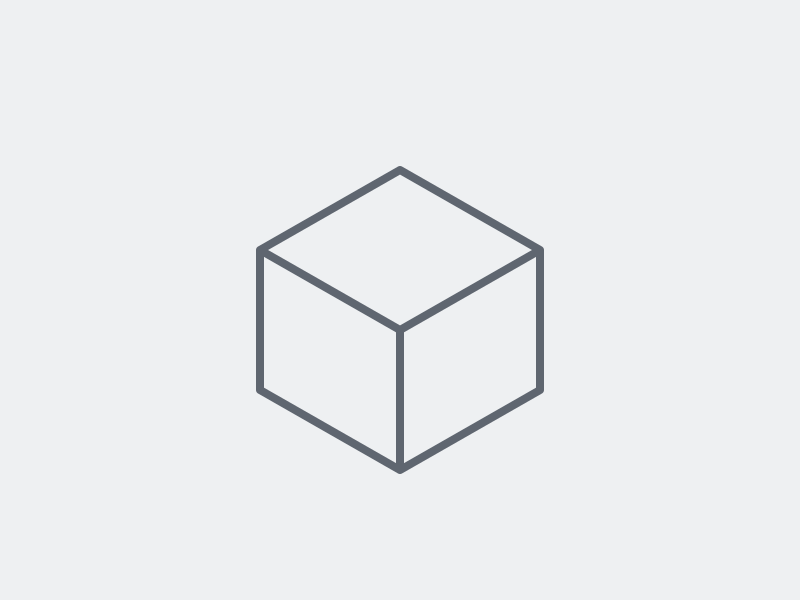

---
# Copy this whole folder to projects/<project-id>/ (no underscore) to create a new project.
# The folder name becomes the address of the project: /projects/<project-id>/

# Name of the project, shown on its page and on its card.
title: Project title
# Year of the project. Lists show the newest first.
year: 2026
# One short sentence shown on the card.
summary: A short description of the project.
# Optional. Image used on the card, relative to this folder.
# Without it, the card uses the first image of this folder; with no image, it shows the title.
cover: cover.svg
# Optional. true shows the project on Home. With no featured project, Home shows the newest ones.
featured: false
# Optional. false hides the project from Home and Projects; its page still exists.
listed: true
---

Write about the project here, in Markdown.

An image saved in this folder:

To show a 3D model, put the model and its textures in a folder inside this one
(for example `my-model/`) and link to that folder in a line of its own:

[My model](my-model/)

For a Spanish version, add `index.es.md` to this folder with the same fields and links.
